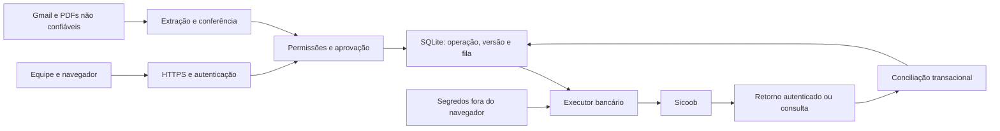

# Segurança Ecosol–Sicoob: levantamento atual

Este mapa registra a base antes das correções da revisão de organização. Para as mudanças posteriores em configuração, proteção HTTP, links de desenvolvimento e recuperação de senha, consultar [Organização e segurança](../organizacao-e-seguranca.md).

Data: 16/10/2026. Escopo: inspeção estática dos componentes citados e execução das suítes locais indicadas no documento 04. Não é um pentest nem uma homologação bancária. Nenhum dado de produção ou segredo foi consultado para este levantamento.

## Resultado

Há base reaproveitável para autenticação, autorização, cálculo e histórico. Não há módulo Sicoob nos arquivos de servidor inspecionados. O sistema atual não deve ser considerado autorizado ou preparado para movimentar dinheiro por API.

Capacidade desejada: 170 boletos emitidos/dia, recebimentos de até R$ 200 mil/dia e até 70 contas/R$ 400 mil pagos/dia. São requisitos informados pela operação, não limites concedidos pelo banco. Maior valor individual e número de responsáveis financeiros ainda não informados.

## Controles encontrados e evidências

Todos os caminhos abaixo são relativos à raiz do repositório.

| Área                  | Evidência                                                                                                                                                         | Limite da evidência                                                                                                                    |
| --------------------- | ----------------------------------------------------------------------------------------------------------------------------------------------------------------- | -------------------------------------------------------------------------------------------------------------------------------------- |
| Senhas                | `backend/servidor/autenticacao.mjs`: scrypt com sal, comparação temporal constante e compatibilidade com hash antigo                                              | Não existe MFA ou reautenticação financeira nesse módulo                                                                               |
| Sessões               | Mesmo arquivo: token aleatório de 32 bytes, hash SHA-256 no banco, expiração de sete dias, cookie HttpOnly/SameSite=Lax e Secure em produção; logout apaga sessão | Sessão de sete dias não comprova presença recente para autorizar dinheiro                                                              |
| Permissões            | `permissoesDaEquipe.mjs`: identidade e nível lidos do banco; `exigirNivel` no backend                                                                             | Apenas níveis hierárquicos; não separa preparador, aprovador e administrador de integração                                             |
| Inicialização         | Acesso inicial sem staff_id só é aceito quando não há administrador                                                                                               | Novo módulo bancário deve exigir usuário nominal, nunca acesso inicial                                                                 |
| Origem HTTP           | `iniciar.mjs`: rejeita origem diferente em métodos mutantes quando Origin está presente; limites de corpo                                                         | Ausência de Origin é permitida; complementar proteção nas operações bancárias. Não foi demonstrada exploração CSRF                     |
| Implantação           | `iniciar.mjs`: escuta em 127.0.0.1 e carrega `.env.local`; Secure depende de NODE_ENV                                                                             | TLS/proxy, permissões do host e configuração real de produção não foram verificados                                                    |
| Segredo Gmail         | `gmail/credenciais.mjs`: AES-256-GCM, nonce aleatório e AAD vinculado à conta                                                                                     | É proteção específica Gmail; não reutilizar sua chave para banco. Não comprova proteção do disco ou cofre externo                      |
| Persistência          | `bancoDeDados.mjs`: SQLite, WAL e busy_timeout; transações curtas em faturamento; `gmail/esquema.mjs`, chamado pelo inicializador, ativa foreign_keys             | Ativação está acoplada ao preparo Gmail; novas conexões/workers precisam garantir a mesma configuração e validar integridade do legado |
| Cálculo               | `faturamento/rotas.mjs`, rotas calcular/aprovar: versão, hash de prévia, memória persistida e comparação com cadastro atual                                       | Aprovação interna não é emissão nem dupla autorização de pagamento                                                                     |
| Documentação pendente | `faturamento/esquema.mjs`: triggers impedem status Emitida para UC com cliente operacional                                                                        | Bloqueio deve ocorrer também antes da chamada externa; trigger depois da chamada não desfaz boleto no banco                            |
| Histórico             | `faturamento/registros.mjs`: operador, ação e dados no SQLite                                                                                                     | Registro local não é evidência inviolável contra administrador do host; minimizar dados e criar cópia independente                     |
| Logs                  | Faturamento registra nome/código de erro; handler global em `iniciar.mjs` registra objeto erro inteiro                                                            | Erros de SDK bancário devem ser sanitizados antes de chegar ao handler global                                                          |
| Exclusão Git          | `.gitignore` exclui banco, WAL, SHM e `.env.local`                                                                                                                | Certificados bancários não possuem regra específica; armazenar fora do checkout e prevenir inclusão acidental                          |
| Recuperação           | README pede backup consistente; há scripts operacionais e orientação sobre WAL                                                                                    | Não foi comprovada rotina externa automatizada nem restauração com reconciliação bancária                                              |

## Fronteiras de confiança

Ativos: credenciais/certificados, saldo, documentos pessoais, instruções de pagamento, memória de cobrança, comprovantes, auditoria e backups. Atores: operador, aprovador, administrador técnico, auditor, cliente e processos automáticos. Cliente não acessa conta bancária nem operações de outros clientes; listas e PDFs exigem verificação de vínculo no servidor.

## Lacunas priorizadas

São lacunas para a futura integração, não afirmações de exploração bancária existente.

| ID / prioridade | Condição e impacto                                                                                       | Tratamento proposto                                                                                     |
| --------------- | -------------------------------------------------------------------------------------------------------- | ------------------------------------------------------------------------------------------------------- |
| S01 / HIGH      | Reutilizar nível 3 para preparar e autorizar saída permitiria concentração de poder                      | Permissões explícitas, autor nominal, dois responsáveis distintos e aprovação vinculada à versão        |
| S02 / HIGH      | Reenvio após timeout ou reinício poderia duplicar operação externa                                       | Registro único, fila durável, tentativa rastreada e reconciliação do resultado desconhecido             |
| S03 / HIGH      | Enviar antes de validar documentação ou aprovação poderia criar boleto impossível de reverter localmente | Todas as validações antes do envio; memória imutável da operação e revisão de identidade real           |
| S04 / HIGH      | Restauração de backup antigo poderia repetir operações já feitas                                         | Pausar despachos na restauração, consultar banco e recuperar IDs antes da retomada                      |
| S05 / HIGH      | Credenciais em frontend, checkout ou logs permitiriam uso fora do fluxo autorizado                       | Credenciais exclusivamente no servidor, escopos mínimos e sanitização de erros                          |
| S06 / MEDIUM    | Sessão longa roubada poderia autorizar ações sem presença recente                                        | MFA/reautenticação recente para aprovações e administração bancária; invalidar autorização após mudança |
| S07 / MEDIUM    | Retorno forjado/repetido poderia produzir baixa indevida                                                 | Contrato oficial de autenticação, deduplicação e consulta confirmatória conforme capacidade da API      |
| S08 / MEDIUM    | Auditoria no mesmo host e backups sem restauração comprovada limitam recuperação                         | Cópia protegida externa, acesso restrito e ensaio de restauração                                        |

## Pendências externas

Obter contrato oficial das APIs habilitadas, regras de autenticação/certificados, escopos, homologação, limites, horários, confirmação de beneficiário, consultas por referência, cancelamento e notificações. Não pressupor webhook, header de idempotência ou consulta por chave específica antes de ler o contrato.

Fontes oficiais já consultadas: https://developers.sicoob.com.br/portal/apis e catálogo público Sicoob de APIs. CNAB é alternativa a homologar pelo layout vigente da cooperativa. A capacidade pública anunciada não comprova habilitação da conta Ecosol.

Próximos documentos: [permissões](02-permissoes.md), [operações e recuperação](03-operacoes-e-recuperacao.md), [testes e liberação](04-plano-de-testes.md).
