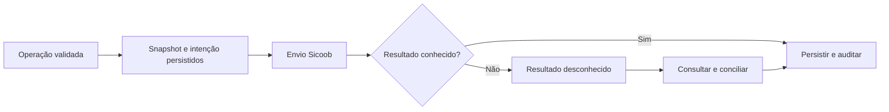

# Operações, persistência e recuperação

Status em 23/10/2026: núcleo local, executor simulado, OAuth Client Credentials, mTLS, contrato de Cobrança Bancária v3, inclusão, consulta e persistência de artefatos implementados e testados localmente com dados sintéticos. Cobranças são emitidas por contas nominais da equipe sem aprovação ou senha adicional. A fundação de aprovação de pagamentos exige exclusivamente o Proprietário, senha atual e confirmação bancária; criação e envio real de pagamentos continuam pendentes.

## Entrega local implementada

- `bancario_operacoes`: identidade lógica, BRL em centavos, origem/versionamento, snapshot canônico, hash, idempotência, estado e preparador.
- Cobranças novas entram no estado `aprovada` sem registro de aprovação adicional; o cálculo aprovado, o snapshot e a idempotência continuam obrigatórios.
- `bancario_aprovacoes_pagamento_proprietario`: aprovação exclusiva de pagamento vinculada à versão e ao hash, com Proprietário vigente e evidência auditável do uso da senha financeira, sem persistir senha ou código temporário.
- `bancario_credencial_confirmacao` e `bancario_recuperacoes_credencial`: hash da senha financeira e recuperação de uso único geridos exclusivamente pelo Proprietário 1.
- `bancario_intencoes`: uma intenção de emissão por operação/versão, pronta para o futuro executor.
- `bancario_auditoria_operacoes`: preparação, aprovação e entrada na fila com ator e transição.
- `bancario_artefatos_cobranca`: `nossoNumero`, linha digitável, código de barras, QR Code, PDF e hash do PDF, sem expor esses dados em logs.
- Triggers rejeitam transições inválidas, aprovação de pagamento divergente e intenção de pagamento sem aprovação vigente do Proprietário.
- A origem é revalidada imediatamente antes da fila; mudança na fatura exige nova preparação, mas cobrança não exige uma aprovação bancária separada.
- `SICOOB_AMBIENTE` aceita `homologacao` ou `producao`; `SICOOB_CONTA_REFERENCIA` é apenas uma referência interna, nunca credencial ou número secreto. Homologação é o padrão local enquanto não houver conexão externa.

## Executor simulado

- Nasce desligado (`BANCARIO_EXECUTOR_MODO=desligado`) e pausado no banco.
- Só aceita `BANCARIO_EXECUTOR_MODO=simulado` quando `SICOOB_AMBIENTE=homologacao`.
- Assume a intenção atomicamente, com identidade e prazo de posse; outro processo não pode assumir a mesma tarefa ativa.
- A chamada simulada ocorre fora da transação SQLite.
- Falha confirmadamente anterior ao envio pode ser repetida com espera progressiva, até oito tentativas.
- Timeout, queda com posse expirada ou erro não classificado viram `resultado_desconhecido`; os ciclos seguintes apenas consultam e nunca repetem o envio.
- Uma consulta sem resultado mantém a operação desconhecida para conferência, pois “não encontrado” não prova que o banco nunca aceitou a requisição.
- A origem e a aprovação são revalidadas imediatamente antes do primeiro envio. Depois de um resultado inconclusivo, a consulta continua mesmo que o cadastro mude, pois a prioridade passa a ser reconciliar o possível efeito externo.
- Tentativas guardam etapa, correlação, categoria e código sanitizado, sem payload bancário ou credencial.
- Pausa e retomada exigem administrador da integração e ficam auditadas.

O simulador mantém registros apenas no SQLite local e não reproduz endpoints, códigos ou garantias reais do Sicoob. Portanto, processar a fila simulada não emite boleto nem movimenta dinheiro.

## Arquitetura proporcional

Manter Node/Express, React e SQLite enquanto a capacidade for demonstrada nos testes. Criar módulo `bancario` com política de autorização, serviço de operações, repositório, executor de fila, conciliação e adaptador Sicoob. Não introduzir broker ou outro banco inicialmente. SQLite exige transações curtas: nunca manter transação aberta durante chamada HTTP.

Fila durável no próprio banco é preferível a chamadas diretas dentro da requisição do navegador: permite retomar após reinício e acompanhar resultado desconhecido. Usar claim atômico e prazo de posse para trabalhadores concorrentes. Posse expirada após início de envio exige reconciliação, não novo POST automático.

API é o canal principal proposto. CNAB é alternativa assistida, com arquivo versionado, hash, sequência, protocolo de transmissão e retorno por item. Os dois canais compartilham a identidade da operação: não trocar de canal enquanto o resultado anterior estiver desconhecido.

## Entidades propostas

| Entidade               | Dados/garantias principais                                                                           |
| ---------------------- | ---------------------------------------------------------------------------------------------------- |
| Conta integrada        | CNPJ, conta, ambiente, capacidades habilitadas e referência do segredo; sem segredo em resposta HTTP |
| Operação               | UUID, tipo, origem, versão, snapshot, hash, BRL, valor em centavos, estado e ID bancário             |
| Aprovação              | Operação/versão/hash, preparador, aprovador, data e evidência de reautenticação sem token bruto      |
| Intenção/fila          | Uma intenção por operação/ação/versão, claim, prazo, tentativas e próxima consulta                   |
| Tentativa              | Correlação, horário, categoria de resultado e ID externo; sem payload sensível bruto                 |
| Retorno recebido       | Identificador do evento quando existir, hash, verificação e aplicação transacional                   |
| Liquidação/conciliação | Recebido bruto, tarifas, líquido, data e vínculo bancário; diferenças preservadas                    |
| Auditoria              | Ator, operação, conta, transição e motivo; cópia externa protegida para resistência a alteração      |

Persistir valores monetários em centavos inteiros dentro de faixa segura; usar Decimal para tarifas/cálculos e arredondamento explícito antes do envio. Enviar no formato exato exigido pelo contrato bancário. Snapshot mantém a memória do cálculo e a UC atual emitida, mesmo que cadastros mudem depois.

Unicidade: cobrança por origem/versão autorizada, tipo, conta e ambiente; ID bancário único nesse escopo. Para pagamentos, comparar também referência do título/linha normalizada para detectar a mesma obrigação importada mais de uma vez. Correção de boleto exige versionamento e tratamento explícito da cobrança anterior. UNIQUE local não garante execução única no banco.

## Estados

Cobrança: `preparada → registro_pendente → registrada → liquidada`. Rejeição confirmada leva a `rejeitada`; cancelamento passa por `cancelamento_pendente → cancelada` somente com confirmação. Resposta inconclusiva leva a `resultado_desconhecido`, resolvido por consulta/conciliação.

Pagamento: `rascunho → conferido → aguardando_aprovacao → aprovado → envio_pendente → processando/agendado → pago`. Falha confirmada: `falhou`; cancelamento solicitado: `cancelamento_pendente`; estorno confirmado após pagamento: `estornado`, sem apagar o pagamento original. Alteração antes do envio volta à conferência.

Na interface de recebíveis, preservar pago/vencido/a receber; vencido deriva do vencimento e ausência de liquidação, não é prova de falha bancária. Cancelados, rejeitados e resultados desconhecidos precisam de indicação específica, sem aparecer falsamente como cobrança ativa. Baixa/cancelamento bancário não significa pagamento.

Eventos fora de ordem não podem rebaixar operação liquidada a pendente. Liquidação tardia de título cancelado gera conferência com o banco; não descartar dinheiro confirmado. Pagamentos parciais, juros e divergências seguem capacidade do contrato; registrar discrepância sem dar quitação integral silenciosa.

## Despacho seguro

1. Validar usuário, conta, ambiente, documentação real, snapshot e aprovação quando for saída de dinheiro.
2. Em transação: conferir versão, reservar limite, criar operação e intenção única; commit.
3. Executor assume intenção, registra tentativa e chama apenas host autorizado com timeout.
4. Persistir resposta e auditoria em nova transação. HTTP aceito não significa liquidado.
5. Timeout, queda do processo ou sucesso externo sem persistência local: manter resultado desconhecido e consultar banco. Utilizar idempotência do provedor somente se documentada.
6. Se o contrato não permitir resolver a ambiguidade automaticamente, encaminhar conferência bancária manual; não reemitir por API ou CNAB às cegas.

## Retornos, falhas e recuperação

Webhook somente se a API contratada o oferecer: validar autenticação oficial, limite de corpo e esquema; persistir recebimento antes do reconhecimento conforme contrato. Deduplicar e aplicar mudança em transação. Consultas periódicas de reconciliação recuperam eventos perdidos, respeitando rate limits; falha de autenticação nunca confirma pagamento.

Em 429/indisponibilidade, aplicar espera progressiva com variação e Retry-After quando previsto. Repetir consultas é diferente de repetir movimentação. Falha de saldo/dados exige correção; rejeição de certificado pausa o envio e alerta a equipe.

Reconciliação por operação e fechamento diário: comparar status, valor bruto, tarifas, líquido e extrato disponível. Não casar somente por valor/data. Comprovante é evidência vinculada, nunca único mecanismo para autorizar baixa automática.

Backup SQLite consistente por mecanismo compatível com WAL, cifrado e fora da máquina; não copiar somente arquivo .db em uso. Proposta inicial a validar: RPO até 15 minutos e RTO até quatro horas. São metas, não garantias atuais.

Restauração: iniciar com executor desabilitado; recuperar segredos por canal separado; conferir integridade e IDs; reconciliar intervalo desde o backup com sobreposição; recuperar operações externas ausentes; resolver ambiguidades e só então liberar a fila. Rollback de código não reverte dinheiro; recuperação financeira depende do estado bancário.

Migração futura aditiva com backup e teste em cópia, verificação de vínculos órfãos e ativação explícita de integridade referencial onde aplicável. Não habilitar foreign_keys às cegas no legado.

Observabilidade: fila pendente, idade do resultado desconhecido, divergências, falhas de autenticação, vencimento de certificado, atraso de retorno e backup. Botão de pausa interrompe novos envios, preservando consulta e conciliação; não cancela agendamentos já aceitos pelo banco.
